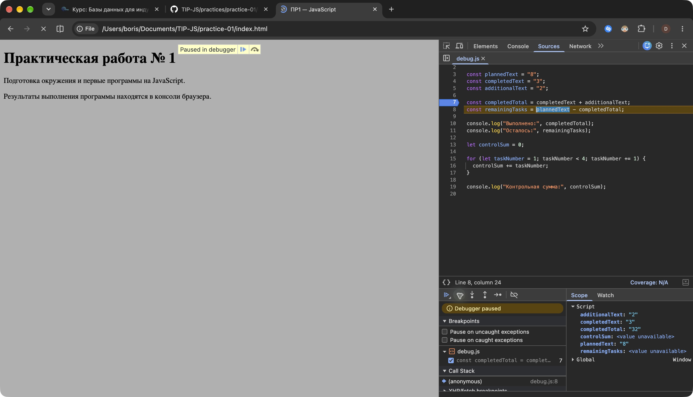

# Практическая работа № 1

Подготовка окружения и первые программы на JavaScript. Выполнены пять обязательных заданий и расширение «План с выходными днями».

## Автор и вариант

ФИО и группа ожидают уточнения. Индивидуальный вариант определяется по формуле `((N - 1) % 8) + 1`, где N — номер в журнале. Пока установлен общий пример `12, 5, 3`, а не заявленный индивидуальный вариант.

Задание: [ПР1 на GitHub](https://github.com/adyshkins/TIP-JS/blob/37fd64e6f09e728e60e6304d50eda07c398bbd1c/practices/practice-01/PR01_JavaScript.md).

## Окружение

Проверено 19 октября 2026 года: macOS 27.0.1 (26A434), Node.js v24.21.0, npm 11.19.0, Git 2.54.0 (Apple Git-157), Google Chrome. Сторонние пакеты не устанавливались.

## Запуск

Команды из корня TIP-JS:

```bash
node practice-01/js/hello.js
node practice-01/js/types.js
node practice-01/js/progress.js
node practice-01/js/plan.js
node practice-01/js/debug.js
node practice-01/js/plan-week.js
node practice-01/checks.mjs
```

В браузере открыть `practice-01/index.html`, затем Console в DevTools. В `script src` временно указывается нужный файл. Подключается только один файл за раз; после изменения нужны сохранение и перезагрузка. Перед сдачей возвращён `./js/hello.js`.

Для воспроизводимого запуска всех файлов открыть [checks.html](checks.html): каждая программа запускается в своём iframe, результаты выводятся на странице проверки. Обязательные программы сами выводят результат в консоль.

## Задание 1

Один файл `hello.js` запущен в Node.js и Chrome. В терминале последняя строка — `Тип document: undefined`, в браузере — `Тип document: object`. В браузере есть объект HTML-документа, а обычный Node.js не создаёт DOM. Вывод самой программы находится в консоли, не в HTML страницы.

## Задание 2

Предсказания были записаны до запуска в комментарии `types.js`. Все десять выражений фактически выполнены в Node.js и браузере.

| Выражение | Ожидание до запуска | Фактическое значение | Тип результата | Объяснение |
|---|---|---|---|---|
| `"8" + 2` | `"82"`, string | `"82"` | string | Строковый операнд превращает сложение в конкатенацию. |
| `"8" - 2` | `6`, number | `6` | number | Вычитание преобразует строку в число. |
| `Number("8") + 2` | `10`, number | `10` | number | После явного преобразования складываются два числа. |
| `"12" > "3"` | `false`, boolean | `false` | boolean | Строки сравниваются посимвольно; символ `1` меньше `3`. |
| `12 === "12"` | `false`, boolean | `false` | boolean | Типы различаются; строгое равенство их не преобразует. |
| `Number("")` | `0`, number | `0` | number | Пустая строка по правилам Number преобразуется в ноль. |
| `Number("text")` | `NaN`, number | `NaN` | number | Строка не представляет число. NaN остаётся значением числового типа. |
| `Boolean("false")` | `true`, boolean | `true` | boolean | Любая непустая строка истинна, независимо от её текста. |
| `typeof null` | `"object"`, string | `"object"` | string | Историческая особенность typeof. Сам null — примитив; результат оператора — строка. |
| `typeof NaN` | `"number"`, string | `"number"` | string | NaN относится к числовому типу; typeof возвращает строку с его названием. |

## Задания 3 и 4

Проверка целочисленности одновременно отклоняет строки, NaN и бесконечность. Затем проверяются диапазоны. В `progress.js` нулевой случай обработан до деления. Статус вычисляется по количествам, процент округляется только для вывода.

В `plan.js` дневная норма проверяется даже при нулевом остатке. Цикл `while` уменьшает остаток на `Math.min(dailyLimit, remainingTasks)`. Последний день не создаёт отрицательный остаток. Счётчик дней увеличивается только при выполнении задачи.

Общий пример `12, 5`: осталось 7, прогресс 41.7%, статус «В работе». План `12, 5, 3`: выполнено 3, 3, 1, остатки 4, 1, 0, всего 3 дня.

Все обязательные и дополнительные граничные проверки представлены в [таблице фактических результатов](checks-results.md). Проверено 14 наборов для прогресса, 13 для плана и 6 для расширения — 33 набора. Проверочный инструмент подставляет исходные значения в исходный код и проверяет его вывод. Он отдельно проверяет число итераций, сумму выполненных задач и неотрицательность остатка. Обязательные программы содержат только пройденные в ПР1 конструкции, без собственных функций и массивов.

## Задание 5 и отладка

До исправления фактический вывод Node.js: выполнено `32`, осталось `-24`, контрольная сумма `6`. Исходная ошибочная версия сохранена в начальном Git-коммите.

В Chrome Sources установлена точка на строке 7 перед вычислением `completedTotal`. В Scope видны строки `completedText = "3"` и `additionalText = "2"`. После одного Step over получено `completedTotal = "32"`.



Внутри цикла поставлена точка на строке 16. Перед выполнением тела наблюдались пары `(taskNumber, controlSum)`: `(1, 0)`, `(2, 1)`, `(3, 3)`. При `taskNumber = 4` условие `< 4` уже ложно: число 4 не попадает в сумму.

| Ошибка | Наблюдение | Причина | Исправление | Факт после исправления |
|---|---|---|---|---|
| Количество задач | `completedTotal = "32"`, остаток `-24` | Оператор + объединяет две строки; вычитание затем преобразует строку "32" в число. | Явный Number для каждого исходного значения. | Выполнено 5; осталось 3. |
| Граница цикла | Сумма 1 + 2 + 3 = 6 | Условие `< 4` исключает последнюю задачу. | Условие `<= 4`. | Контрольная сумма 10. |

Исправленный файл реально повторно запущен в Chrome и Node.js: `5`, `3`, `10`. Учебные точки останова отключены.

## Дополнительное задание

`plan-week.js` начинает неделю с понедельника, выполняет задачи только в дни 1–5 и пропускает субботу и воскресенье. Считаются рабочие дни с задачами и все календарные дни до завершения. Выходные после последней задачи не добавляются.

Контрольный набор `6, 0, 1` дал 6 рабочих и 8 календарных дней. Дополнительно проверены окончание в пятницу (`5, 0, 1` → 5/5), окончание после выходных (`7, 0, 1` → 7/9), отсутствие остатка (`5, 5, 2` → 0/0), неполный последний день (`12, 5, 3` → 3/3), две недели (`14, 0, 1` → 14/18). Фактические результаты есть в общей таблице.

## Ответы на контрольные вопросы

1. JavaScript — язык; Node.js — среда его исполнения. DOM предоставляет браузер.
2. const подходит для значения без переприсваивания; let — для счётчиков. const запрещает менять привязку переменной, не делает объект неизменяемым.
3. 12 — число, "12" — текст; тип влияет на операции и строгое сравнение.
4. Если один операнд + строковый, результат может быть объединением текста.
5. === не выполняет приведение типов; == может его выполнять.
6. Number("") возвращает 0: пустой ввод нужно проверять отдельно.
7. NaN и Infinity имеют тип number; также нужны целочисленность и диапазон.
8. Сначала недопустимые данные, затем отсутствие задач, потом обычный расчёт.
9. Валидная положительная дневная норма уменьшает остаток. Нулевая норма привела бы к бесконечному циклу.
10. В последнюю итерацию задач может оставаться меньше нормы; берётся минимум нормы и остатка.
11. Точка останова показывает промежуточные значения, типы и порядок исполнения до неверного итогового вывода.
12. Сохранение меняет файл на диске; коммит фиксирует снимок в локальной истории; push отправляет коммиты на удалённый сервер.

## Вывод

Реализованы типизация и преобразования, проверки входных чисел, ветвления, циклы и отладка. Показательная ошибка — отсутствие исключения при неверном результате: "3" + "2" выполняется успешно, но даёт строку "32". Поэтому корректность подтверждается проверками и наблюдением промежуточных значений.
