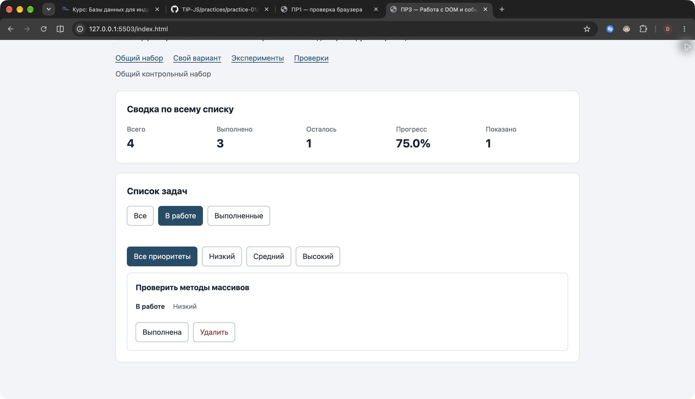

# Практическая работа № 3

Работа с DOM и событиями. Автор: Нехорошев Борис Алексеевич, ЭФБО-17-25. Номер в журнале 19; вариант `((19 - 1) % 8) + 1 = 3` — сайт-портфолио.

## Окружение и запуск

Проверено 19 октября 2026 года в macOS 27.0.1, Node.js v24.21.0, npm 11.19.0, Git 2.54.0 и Google Chrome. Версия браузера дополнительно записана в [протоколе окружения](results/environment.txt). Сторонние зависимости не нужны.

Из корня репозитория:

```bash
node practice-03/checks/service.checks.js
node practice-03/tools/serve.mjs
```

Либо из `practice-03`: `npm run check:service`, затем `npm start`. Сервер остаётся работающим. Открыть в Chrome [приложение](http://127.0.0.1:5503/), [готовые проверки](http://127.0.0.1:5503/checks.html), [собственные проверки](http://127.0.0.1:5503/examples/own-checks.html). Для остановки сервера — Ctrl+C. При занятом порте указать другой последним аргументом команды сервера.

ES-модули загружаются через HTTP, открытие index.html как file:// для этой работы не используется. Каждая папка работы самостоятельна: все нужные модули ПР2 скопированы внутрь ПР3.

Задание: [методичка ПР3](https://github.com/adyshkins/TIP-JS/blob/37fd64e6f09e728e60e6304d50eda07c398bbd1c/practices/practice-03/README.md).

## Задание 1 — DOM и события

Прогнозы записаны перед действиями в [отдельном файле](results/dom-experiments-predictions.txt). Эксперименты выполнены на `examples/dom-events.html` в Chrome.

| № | Прогноз | Фактическое наблюдение | Причина |
|---|---|---|---|
| 1 | null и длина 0 | `Отсутствующий элемент: null`, `Пустая коллекция: 0` | querySelector не нашёл элемент; querySelectorAll вернул пустой NodeList. Обращение к свойству null без проверки вызвало бы ошибку. |
| 2 | "23" string → 23 number | Console: `dataset.taskId: 23 string`; `Числовой id: 23`; отдельно typeof после Number — `number` | dataset хранит строки; преобразование выполняется явно. |
| 3 | Старый NodeList — 1; новый запрос после двух добавлений — 3 | После первого добавления 1/2, после второго 1/3 | querySelectorAll возвращает статический снимок коллекции. |
| 4 | Буквальный текст с тегами, вложенных strong нет | Заголовок `<strong>Это текст, а не HTML</strong>`; запрос strong вернул 0 | textContent не интерпретирует строку как HTML. |
| 5 | Захват контейнера 1 → обработчик кнопки 3 → всплытие контейнера 3 | Именно эта последовательность; target везде lab-label; currentTarget: lab-card, lab-button, lab-card | Цель — вложенный span. На его родительской кнопке событие уже находится в фазе всплытия. |

Точка останова поставлена на строке 25 `dom-events.js`. Нажатие выполнено на тексте вложенного span. Во время остановки проверено: `event.target.id = "lab-label"`, `event.currentTarget.id = "lab-button"`, `event.eventPhase = 3`. Точка отключена после проверки.

[Снимок исследования события](screenshots/dom-events-breakpoint.png).

## Задания 2–4 — модули и поведение

`data.js` содержит общий набор и вариант. `task-service.js` — проверенные операции ПР2, без DOM. `task-selectors.js` возвращает новый массив по статусу. `task-view.js` создаёт карточки через createElement и textContent и заменяет дочерние элементы списка через replaceChildren. `main.js` хранит текущее состояние и обрабатывает события. Расширение по приоритету вынесено в `task-extra.js`.

Карточка — li.task-card с data-task-id, названием, статусом, приоритетом и двумя кнопками. У статуса установлен aria-pressed. Название с разметкой выводится буквальным текстом. Повторный рендер не создаёт дубликаты и сохраняет контейнер с делегированным обработчиком.

Обработчик на списке через closest находит кнопку и карточку, проверяет действие, переводит dataset в число и проверяет положительный безопасный id. Затем находит актуальную запись и вызывает сервис. Только успешный result.tasks становится новым состоянием. Отказ показывает понятное сообщение и сохраняет данные. После перерисовки восстанавливается фокус кнопки либо активного фильтра.

Сводка всегда рассчитывается по полному массиву через getTaskStats; количество показанных записей берётся из выборки. Пустой список и отсутствие совпадений фильтра имеют разные сообщения. Подписки устанавливаются один раз вне renderApp.

## Задание 5 — общий сценарий

Сценарий выполнен последовательно в Chrome после загрузки общего набора. Каждая строка факта соответствует наблюдаемому состоянию; ожидания взяты из методички.

| Шаг | Действие | Ожидание: видимые id; всего/выполнено/осталось; прогресс | Факт | Итог |
|---|---|---|---|---|
| 0 | Загрузка, Все | [1,4,7,10]; 4/2/2; 50.0% | [1,4,7,10]; 4/2/2; 50.0% | Пройдено |
| 1 | В работе | [4,7]; 4/2/2; 50.0% | [4,7]; 4/2/2; 50.0% | Пройдено |
| 2 | Выполнить 4 | [7]; 4/3/1; 75.0% | [7]; 4/3/1; 75.0% | Пройдено |
| 3 | Все | [1,4,7,10]; 4/3/1; 75.0% | [1,4,7,10]; 4/3/1; 75.0% | Пройдено |
| 4 | Удалить 7 | [1,4,10]; 3/3/0; 100.0% | [1,4,10]; 3/3/0; 100.0% | Пройдено |
| 5 | В работе | []; 3/3/0; 100.0% | []; 3/3/0; 100.0%; «Нет задач по выбранному фильтру.» | Пройдено |
| 6 | Все, переключить 1 пробелом | [1,4,10]; 3/2/1; 66.7% | [1,4,10]; 3/2/1; 66.7% | Пройдено |
| 7 | Удалить 1,4,10 | []; 0/0/0; 0.0% | []; 0/0/0; 0.0%; «Список задач пуст.» | Пройдено |

Показано всегда равно длине видимого списка. После перезагрузки восстановились четыре исходные задачи, 2 выполненные и 50.0%. Это ожидаемое поведение ПР3 без сохранения.

Клавиатурная проверка выполнена нативно: Tab перевёл фокус на кнопку статуса первой задачи, пробел переключил её один раз; после перерисовки фокус сохранился на этой кнопке.



## Отладка обработчика

В Sources установлены точки на строках 54 и 68 `main.js`. На строке чтения dataset действие равно toggle, карточка соответствует задаче 4. После двух шагов: idText = "4" (string), id = 4 (number). На следующей остановке найдена исходная задача 4 с completed=false; result содержит ok=true и новый массив из четырёх записей. После продолжения задача исчезла из выборки «В работе», общая сводка стала 4/3/1 и 75.0%.

[Снимок результата сервиса до присваивания нового состояния](screenshots/task-breakpoint.png). Обе точки отключены после отладки.

Отказы при data-task-id="777" и "4abc" проверены готовыми браузерными сценариями: данные сохраняются, выводится ошибка, корректный выбор фильтра очищает сообщение и восстанавливает карточки из состояния. Неизвестное действие игнорируется.

## Проверки и вариант 3

Фактические протоколы:

- [Сервис ПР2 внутри ПР3](results/service-checks.txt): 35 пройдено, 0 ошибок.
- [Готовые браузерные проверки](results/browser-checks.txt): 36 пройдено, 0 ошибок.
- [Собственные браузерные проверки](results/own-checks.txt): 7 пройдено, 0 ошибок.

| Собственный случай | Ожидание | Факт |
|---|---|---|
| Единственная оставшаяся задача 7, переключить дважды и удалить | 100% → 0% → пустой список | Совпало; в конце 0/0/0 и 0.0% |
| Пять переключений 4 после повторных фильтраций | 4 выполнена; общая сводка 4/3/1 и 75.0% | Совпало, одно нажатие даёт одно изменение |
| Название длиной 100 у замороженной записи | Полный текст, два разных DOM-узла, исходные поля сохранены | Совпало |

Вариант 3 открыт через `?dataset=variant`: изначально id [11,23,37,41,58,64], выполнены [11,23], 6/2/4, 33.3%. Фильтр «В работе» показывает [37,41,58,64], «Выполненные» — [11,23]. После переключения 23 и удаления 37 фактически остались [11,23,41,58,64], 5/1/4, 20.0%. Затем проверены фильтры: выполненная [11], невыполненные [23,41,58,64]. Названия и приоритеты оставшихся записей сохранены.

## Дополнительное задание и вывод

Выполнен вариант А: отдельная группа фильтров по приоритету. Фильтры применяются совместно со статусом; общая сводка не зависит от выбора. Проверены три собственных случая: pending+high с выполнением 4 и сохранением фильтров; completed+low без совпадений с возвратом обоих фильтров; удаление 4 под high с общей сводкой 3/2/1 и 66.7%. Все прошли.

DOM является отображением текущего массива. Делегирование сохраняет работоспособность после замены карточек, а разделение сервиса, выборки и отображения позволяет менять видимость без потери задач. Идентификатор связывает кнопку с записью; индекс массива для этого не используется.

