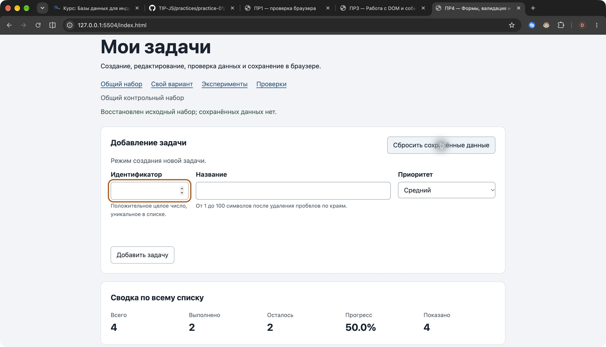

# Практическая работа № 4. Формы, валидация и локальное хранение данных

## Данные работы

| Поле | Значение |
|---|---|
| Автор | Нехорошев Борис Алексеевич |
| Группа | ЭФБО-17-25 |
| Номер в журнале / вариант | 19 / `((19 - 1) % 8) + 1 = 3`, создание сайта-портфолио |
| Дата проверки | 19.10.2026 |
| Node.js / npm | v24.21.0 / 11.19.0 |
| Git | 2.54.0 (Apple Git-157) |
| Браузер | Google Chrome 155.0.8059.84 |
| ОС | macOS 27.0.1 |

[Методичка](https://github.com/adyshkins/TIP-JS/tree/37fd64e6f09e728e60e6304d50eda07c398bbd1c/practices/practice-04), [окружение](./results/environment.txt).

## Запуск

Из корня личного репозитория:

```bash
cd practice-04
npm test
npm start
```

Зависимостей нет; `npm install` не требуется. Фактический сервер — `node tools/serve.mjs`, порт 5504.

```text
http://127.0.0.1:5504/
http://127.0.0.1:5504/index.html?dataset=variant
http://127.0.0.1:5504/examples/forms-storage.html
http://127.0.0.1:5504/checks.html
http://127.0.0.1:5504/examples/own-checks.html
```

## Перенос результата ПР3

| Файл | Перенос и изменение |
|---|---|
| `data.js` | Без изменения общего массива и шести задач варианта 3. |
| `task-service.js` | Девять проверенных функций ПР2–ПР3; добавлен `updateTask`. |
| `task-selectors.js` | Фильтры статуса с прежними контрактами. |
| `task-view.js` | Сохранены `textContent`, сводка и пустые состояния; добавлена кнопка `edit`. |

После переноса прежние 35 проверок сервиса прошли без ошибок. Использован новый `main.js` ПР4; части ПР3 перенесены в его обработчики. ПР3 остаётся самостоятельным этапом.

## Эксперименты с формой и хранилищем

Все пять опытов выполнены в Chrome на `examples/forms-storage.html`. [Прогнозы до действий](./results/experiment-predictions.txt).

| № | До запуска: прогноз | После запуска: результат | Объяснение |
|---:|---|---|---|
| 1 | Пустое название блокирует отправку до submit. | Журнал не изменился; validity.valid=false; Chrome: `Please fill out this field.` | Нативная проверка предшествует submit. |
| 2 | Пробелы пройдут required, но не прикладную проверку. | Submit вызван; «Название не должно состоять только из пробелов». | Required проверяет пустую строку; trim и custom validity добавляют правило модели. |
| 3 | FormData вернёт строки, навигация будет отменена. | Для `  Учебная задача  ` и low: string, defaultPrevented=true; сохранено `Учебная задача`. | PreventDefault отменяет отправку; trim убирает краевые пробелы. |
| 4 | GetItem вернёт строку, parse — объект. | Тип сохранённого значения string; восстановлен объект с очищенным названием и low. | Объект сериализован через JSON.stringify. |
| 5 | Повреждённый JSON вызовет перехваченное исключение. | `Expected property name or '}' in JSON at position 1 (line 1 column 2)`. | Try/catch сохраняет работоспособность. |

После опытов учебный ключ удалён кнопкой страницы. [Скриншот ошибки JSON](./screenshots/json-error.png).

## Организация кода

`task-service.js` проверяет модель и возвращает новые массивы; `updateTask` меняет только title и priority выбранной записи. `form-validation.js` нормализует черновик и собирает ошибки полей. `task-storage.js` проверяет схему, читает, сериализует и удаляет один ключ, перехватывая исключения. `task-view.js` создаёт DOM и сводку. `main.js` хранит текущее состояние, режим формы и фильтр, связывает события с сервисом, сохранением и отрисовкой.

Аргумент storage явно задаёт зависимость и позволяет проверять ошибки с имитацией хранилища. JSON.parse подтверждает только синтаксис. До использования проверяются версия 1, массив, все поля каждой задачи и уникальность id. Одна неверная запись отклоняет весь список; fallback копируется вместе с объектами. Ошибка доступа к самому window.localStorage также перехватывается на границе приложения.

## Проверка формы

| Сценарий | Ожидание | Фактический результат | Итог |
|---|---|---|---|
| Корректная задача 20, «Изучить localStorage», high | Добавление и JSON | 5 задач, новая невыполненная запись, 40.0% | OK |
| Повторный id 4 | Отказ без изменения и записи | Ошибка около id; массив и число записей прежние | OK |
| Пустое название | Отказ | HTML блокирует отправку | OK |
| Только пробелы | Прикладной отказ | Ошибка title, список прежний | OK |
| Длина 100 | Успех | Создана задача 55 с полными 100 символами | OK |
| Длина 101 | Отказ | ValidateTaskDraft возвращает ошибку title | OK |
| Редактирование title и priority | Меняется одна задача | Id и completed сохранены, в том числе у выполненной записи | OK |
| Отмена | Пустая форма создания | ID включён, отмена скрыта, фокус в ID | OK |

## Общий контрольный сценарий

Все восемь шагов выполнены подряд; [протокол](./results/own-checks.txt).

| Шаг | Действие | Видимые id | Всего | Выполнено | Осталось | Прогресс | Storage |
|---:|---|---|---:|---:|---:|---:|---|
| 0 | Сброс, «Все» | 1,4,7,10 | 4 | 2 | 2 | 50.0% | Ключ отсутствует |
| 1 | Добавить 20, «Изучить localStorage», high | 1,4,7,10,20 | 5 | 2 | 3 | 40.0% | Version 1, 5 задач |
| 2 | Повторный id 4 | 1,4,7,10,20 | 5 | 2 | 3 | 40.0% | Нет дополнительной записи |
| 3 | У 4: «Подготовить форму задач», low | 1,4,7,10,20 | 5 | 2 | 3 | 40.0% | Новые title и priority, completed=false |
| 4 | Переключить 7 | 1,4,7,10,20 | 5 | 3 | 2 | 60.0% | У 7 completed=true |
| 5 | Удалить 1 | 4,7,10,20 | 4 | 2 | 2 | 50.0% | Записи 1 нет |
| 6 | Reload | 4,7,10,20 | 4 | 2 | 2 | 50.0% | Восстановлено из localStorage |
| 7 | Сброс | 1,4,7,10 | 4 | 2 | 2 | 50.0% | Ключ отсутствует |

Рабочие ключи: `tip-js-practice-04:demo`, `tip-js-practice-04:variant`. Автоматические сценарии используют `tip-js-practice-04:checks:*`.

## Проверка восстановления и ошибок

| Случай | Ожидание | Фактический результат | Итог |
|---|---|---|---|
| Записи нет | Независимая копия initial | Source=initial; исходные объекты не меняются | OK |
| Корректная запись | Восстановление | После reload сохранены создание, title, priority, completed и удаления | OK |
| Повреждённый JSON | Fallback и предупреждение | В Chrome записано `{broken-json`; после reload исходные 4 задачи и ошибка | OK |
| Неверная версия/схема | Fallback | Отклонены неизвестная версия, неверные поля и дубликаты id | OK |
| Исключения getItem/setItem/removeItem | Управляемый отказ | Все три исключения перехвачены и возвращают ошибку | OK |
| Сброс | Удаление одного ключа | Текущий ключ отсутствует; посторонний контрольный ключ сохранён | OK |
| Demo и variant | Независимость | Изменения варианта не изменили 4 исходные общие задачи | OK |

Ошибка записи не отменяет успешную операцию в памяти; интерфейс сообщает об отказе сохранения. Повреждённая запись не стирается автоматически и доступна до явного сброса.

## Индивидуальный вариант 3

| id | Исходное название | completed | priority |
|---:|---|---|---|
| 11 | Определить структуру портфолио | true | low |
| 23 | Собрать работы | true | medium |
| 37 | Создать страницу проектов | false | high |
| 41 | Добавить контакты | false | low |
| 58 | Проверить адаптивность | false | medium |
| 64 | Опубликовать портфолио | false | high |

Добавлена 75 «Подготовить страницу контактов», medium. У 23 новое название «Собрать лучшие работы для портфолио», high; completed остался true. Удалена невыполненная 37.

| Этап | Всего | Выполнено | Осталось | Прогресс | Видимые id |
|---|---:|---:|---:|---:|---|
| После исходного сброса | 6 | 2 | 4 | 33.3% | 11,23,37,41,58,64 |
| Добавлена 75 | 7 | 2 | 5 | 28.6% | 11,23,37,41,58,64,75 |
| Изменена 23 | 7 | 2 | 5 | 28.6% | 11,23,37,41,58,64,75 |
| Удалена 37 | 6 | 2 | 4 | 33.3% | 11,23,41,58,64,75 |
| После reload | 6 | 2 | 4 | 33.3% | 11,23,41,58,64,75 |
| После возврата и сброса | 6 | 2 | 4 | 33.3% | 11,23,37,41,58,64 |

Между reload и сбросом открыт общий набор: `[1,4,7,10]`, 4/2/2, 50.0%; изменения туда не попали.

## Собственные проверки

Страница `examples/own-checks.html`: 5 групп, 5 пройдено, 0 ошибок.

| № | Исходное состояние и действия | Ожидание | Фактический результат | Итог |
|---:|---|---|---|---|
| 1 | Demo; создать 55 с title длиной 100, редактировать пробелами и отменить | Отказ не меняет название; отмена очищает форму | 100 символов сохранены, пробелы не применены, режим создания | OK |
| 2 | Demo; создать 99, выполнить, переименовать, удалить 4 и 7, reload | Сохраняются все изменения | `[1,10,99]`, 3/3/0, 100.0%, новые title и priority | OK |
| 3 | JSON с дубликатами id; посторонний ключ; reload и reset | Fallback, удаление лишь текущего ключа | Исходные 4 задачи и предупреждение; посторонний ключ сохранён | OK |
| 4 | Восемь общих шагов подряд | Значения таблицы выше | Совпали промежуточные id и показатели | OK |
| 5 | Вариант: add 75, edit 23, delete 37, reload, demo, reset | 6/2/4, 33.3%; изоляция | Данные восстановлены, demo не менялся, сброс вернул исходные 6 | OK |

## Отладка и клавиатура

В Chrome DevTools точки останова: строка 173 `handleFormSubmit` после validateTaskDraft, строка 185 после сервиса до присваивания состояния. При ID 20, названии с двумя краевыми пробелами и high:

```text
draft = { id: "20", title: "  Изучить localStorage  ", priority: "high" }
checked = { ok: true, value: { id: 20, title: "Изучить localStorage", priority: "high" } }
result.ok = true
result.tasks.at(-1) = { id: 20, title: "Изучить localStorage", completed: false, priority: "high" }
currentTasks.length до присваивания = 4; result.tasks.length = 5
```

После продолжения getItem рабочего ключа вернул JSON-строку с version=1 и пятью задачами. [Фактический просмотр черновика, результата и JSON](./results/debug-storage.txt), [скриншот](./screenshots/form-normalization.png).

Повторный ID 4: checked.ok=false, errors.id сообщает о дубликате; в памяти и storage прежние пять задач, сервис и сохранение не вызываются. [Протокол](./results/debug-duplicate.txt), [скриншот](./screenshots/form-duplicate.png). Затем точки останова отключены, выполнены опыт с повреждённым JSON и сброс.

Клавиатура в Chrome: Tab проходит ID → название → приоритет → отправка. Enter добавил 88 «Проверить клавиатуру» и вернул фокус в ID. Семь Tab от ID — переключатель первой карточки; Space изменил статус, фокус восстановлен на том же переключателе. Tab, Enter открыли редактирование: ID заблокирован, фокус в названии. Три Tab, Enter отменили редактирование: поля пусты, ID включён и сфокусирован. После проверки выполнен сброс. [Протокол](./results/keyboard.txt).

## Вид приложения

Собственный запуск в Chrome после сброса: форма создания и общий набор 4/2/2, 50.0%.



## Дополнительное задание Б: синхронизация двух вкладок

Обработчик storage реагирует только на текущий ключ и localStorage того же origin. LoadTasks проверяет новые данные; обработчик обновляет состояние, сбрасывает форму и перерисовывает список, сохраняя фильтр. Сам обработчик ничего не записывает. Вкладка, сделавшая запись, обновляется собственным обработчиком операции.

Сценарии выполнены в двух одновременно открытых вкладках; повреждение внесено третьей учебной страницей `examples/sync-check.html`, меняющей только тестовый ключ.

| Внешнее действие | Ожидание | Фактический результат во второй вкладке | Итог |
|---|---|---|---|
| Добавить 88 | Появление без reload | `[1,4,7,10,88]`, 5/2/3, 40.0%, сообщение об обновлении | OK |
| Сбросить | Исходный набор | `[1,4,7,10]`, 4/2/2, 50.0%, сообщение о сбросе другой вкладкой | OK |
| Повредить JSON | Fallback и предупреждение | Исходные 4 задачи и ошибка JSON; последующий сброс восстановил обычное состояние | OK |

[Протокол](./results/two-tabs-sync.txt), [скриншот второй вкладки](./screenshots/two-tabs-sync.png).

## Ответы на контрольные вопросы

1. Submit охватывает кнопку и Enter.
2. PreventDefault отменяет стандартную отправку, но не прекращает обработчик; для прекращения нужен return.
3. Обычные поля FormData возвращают строки; отсутствующее — null.
4. Disabled-контролы не отправляются, поэтому id берётся из editingId.
5. HTML проверяет required/min/step/maxlength; модель — trim, уникальность, безопасное целое и допустимые значения.
6. Пробелы — непустая строка, удовлетворяющая required.
7. Пустая custom validity снимает ошибку; reportValidity показывает актуальную.
8. Чистая функция без DOM повторно используется и проверяется в Node.
9. EditingId=null означает создание; id задачи — редактирование.
10. Изменение названия и приоритета должно сохранять статус задачи.
11. LocalStorage хранит строки; объекты сериализуются в JSON.
12. Отсутствие ключа — штатное initial; повреждение — fallback с предупреждением.
13. Правильный синтаксис JSON не проверяет типы, версию и уникальность.
14. Version позволяет отличить поддерживаемый формат от неизвестного.
15. Частичное восстановление незаметно потеряло бы задачи; некорректная запись отклоняется целиком.
16. Аргумент storage явно задаёт зависимость и позволяет имитировать исключения.
17. Ошибка setItem возвращается вызывающему коду; состояние в памяти остаётся, интерфейс предупреждает.
18. Отрисовка только отражает состояние; запись внутри render создала бы лишние побочные эффекты.
19. Фильтр и режим формы — временный интерфейс; по условиям сохраняются задачи.
20. Разные ключи сохраняют независимость demo и variant.
21. Namespace checks изолирует проверки от рабочих данных.
22. RemoveItem удаляет текущий ключ; clear удалил бы все ключи origin.
23. Порт входит в origin; смена порта означает отдельное хранилище.
24. Вручную проверяются клавиатура, фокус, сообщения Chrome, вариант, отладка и расширение в двух вкладках.

## Вывод

Создание, редактирование, переключение и удаление используют сервис и сохраняют новый массив. Дополнены незавершённые места стартового комплекта: валидация, сохранение completed при update, проверка полной схемы, обработка исключений и восстановление фокуса. HTML блокирует простые нарушения до submit; прикладная проверка нормализует модель; чтение JSON отдельно проверяет сохранённые данные. Обязательные сценарии, вариант 3 и расширение Б подтверждены протоколами.

## Протокол проверок сервиса

```text
OK: 01. Создание задачи с явным приоритетом
OK: 02. Приоритет по умолчанию
OK: 03. Удаление краевых пробелов без изменения внутренних
OK: 04. Граничные длины названия и положительный безопасный id
OK: 05. Некорректные названия при создании
OK: 06. Некорректные идентификаторы при создании
OK: 07. Все допустимые приоритеты и отклонение недопустимых
OK: 08. Каждый вызов createTask возвращает новый объект
OK: 09. Поиск по id, а не по индексу
OK: 10. Отсутствующая задача и пустой массив при поиске
OK: 11. Поиск не преобразует строковый id в число
OK: 12. Получение невыполненных задач
OK: 13. Пустой список, все выполнены и все не выполнены
OK: 14. Названия в исходном порядке и пустой список
OK: 15. Сводка по общему набору
OK: 16. Сводка по пустому списку
OK: 17. Сводка: ничего не выполнено и выполнено всё
OK: 18. Процент остаётся числом без предварительного округления
OK: 19. Добавление в конец без изменения входного массива
OK: 20. Добавление в пустой список с приоритетом по умолчанию
OK: 21. Повторяющийся id отклоняется
OK: 22. Добавление не обходит проверки createTask
OK: 23. Изменение completed в обе стороны
OK: 24. completed принимает только boolean
OK: 25. Некорректный или отсутствующий id при изменении статуса
OK: 26. Повторная установка статуса создаёт новый результат
OK: 27. Переименование сохраняет остальные поля
OK: 28. Проверки названия при переименовании
OK: 29. Некорректный или отсутствующий id при переименовании
OK: 30. Удаление по id с сохранением порядка
OK: 31. Удаление единственной записи
OK: 32. Некорректный, отсутствующий id и удаление из пустого списка
OK: 33. Входные объекты не изменяются ни одной операцией
OK: 34. Общий сценарий и все промежуточные сводки
OK: 35. Работа с другим набором, без зависимости от demoTasks

Проверок пройдено: 35; не пройдено: 0.
```

## Протокол проверок новых модулей

```text
OK: 01. updateTask изменяет название и приоритет выбранной задачи
OK: 02. updateTask нормализует название и сохраняет completed
OK: 03. updateTask не изменяет входной массив и объекты
OK: 04. updateTask отклоняет некорректный и отсутствующий id
OK: 05. updateTask отклоняет некорректные название и приоритет
OK: 06. Валидация создания нормализует поля
OK: 07. Валидация отклоняет некорректные id
OK: 08. Валидация отклоняет повторяющийся id при создании
OK: 09. Валидация проверяет название после trim
OK: 10. Валидация принимает только три приоритета
OK: 11. В режиме редактирования используется editingId
OK: 12. Редактирование отсутствующей задачи отклоняется
OK: 13. Валидация не изменяет draft и список
OK: 14. Проверка схемы принимает корректный список
OK: 15. Проверка схемы отклоняет неверную структуру
OK: 16. Отсутствующая запись возвращает независимую копию исходных данных
OK: 17. Корректная запись восстанавливается из хранилища
OK: 18. Повреждённый JSON приводит к безопасному fallback
OK: 19. Неизвестная версия приводит к безопасному fallback
OK: 20. Некорректные задачи из JSON не принимаются
OK: 21. Ошибка getItem перехватывается
OK: 22. Сохранение записывает версию и задачи
OK: 23. Некорректный список не записывается
OK: 24. Ошибка setItem перехватывается
OK: 25. Удаляется только переданный ключ
OK: 26. Ошибка removeItem перехватывается
OK: 27. Результат загрузки не разделяет объекты с fallback

Проверок пройдено: 27; не пройдено: 0.
```

## Протокол браузерных проверок

Фактический итог на `checks.html`: 23 из 23 пройдено, 0 ошибок.

```text
OK: Фильтры ПР3 сохраняют порядок и не изменяют вход
OK: Карточка содержит toggle, edit и delete
OK: Название задачи выводится как текст
OK: Повторная отрисовка списка не накапливает карточки
OK: Сводка использует полный список и отдельный visibleCount
OK: Пустые состояния различают список и фильтр
OK: Приложение запускается с исходным набором
OK: Корректная форма добавляет задачу и сохраняет данные
OK: Повторяющийся id отклоняется без записи
OK: Название из пробелов отклоняется прикладной проверкой
OK: Нативные ограничения не пропускают пустую форму
OK: Кнопка edit заполняет форму и блокирует id
OK: Редактирование меняет title и priority, сохраняя completed
OK: Отмена редактирования возвращает режим создания
OK: Успешная отправка очищает ошибки и форму
OK: Изменение статуса сохраняется
OK: Удаление сохраняется
OK: Фильтр не записывается, но сохраняется после изменения данных
OK: Перезагрузка восстанавливает сохранённые задачи
OK: Сброс удаляет ключ и восстанавливает исходный набор
OK: Повреждённый JSON не ломает запуск
OK: Некорректная схема из storage заменяется исходным набором
OK: Общий и индивидуальный наборы используют разные ключи
```
