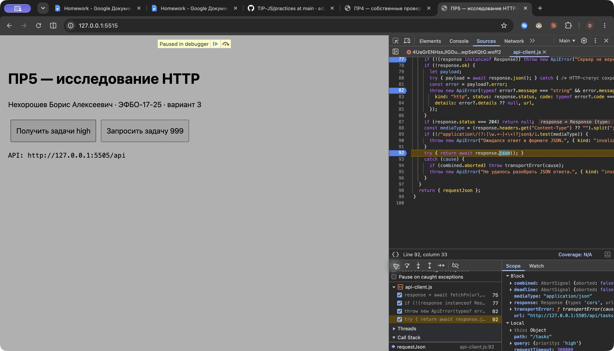
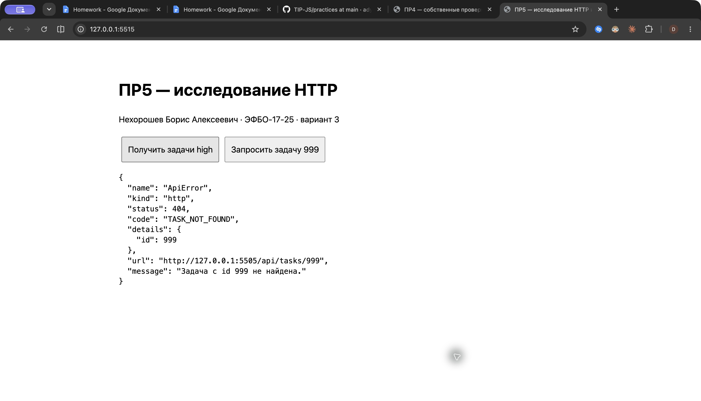

# Практическая работа №5 — асинхронные операции и HTTP

Нехорошев Борис Алексеевич, ЭФБО-17-25. Номер в журнале 19, вариант 3.
Проверено 02.11.2026: Node.js v24.21.0, npm 11.19.0, Git 2.54.0 (Apple Git-157), macOS, Google Chrome 156.0.8078.74. Пакеты не устанавливались.

[Методичка](https://github.com/adyshkins/TIP-JS/blob/37fd64e6f09e728e60e6304d50eda07c398bbd1c/practices/practice-05/README.md). [Опубликованное решение](https://github.com/DansonDev/tip-js-practices/tree/main/practice-05).

## Запуск

Из папки `practice-05`:

```bash
npm test
node checks/own.checks.js
```

Ручная работа — два терминала. В первом:

```bash
npm start
```

Во втором:

```bash
npm run example:order
node examples/event-loop-own.js
npm run example:fetch
npm run client -- --demo
npm run client
node examples/http-observations.js
```

API: `http://127.0.0.1:5505/api`. Порт по методичке, зависимости отсутствуют. При другом порте: `node api/server.mjs 5516`, во втором терминале `API_URL=http://127.0.0.1:5516/api npm run client`.

Для воспроизведения отладки: при работающем API отдельно `node tools/serve-lab.mjs`, открыть `http://127.0.0.1:5515/` в Chrome. Это вспомогательная лабораторная страница; DOM-приложение ПР4 к API в этой работе не подключается.

## Исходная диагностика

Готовый сервер до реализации клиента: 18/18. Клиентская заготовка: 0/26, код завершения 1, ошибки «Не реализовано»; [исходный вывод](./results/initial-client.txt). После реализации: 18/18 API, 26/26 клиент, 13/13 интеграция, 9/9 собственных групп. Файлы готового API и штатных проверок сохранены без изменений.

## Очереди выполнения

Прогноз записан [до запуска](./results/predictions.txt).

| Опыт | Прогноз | Факт | Объяснение |
|---|---|---|---|
| Исходный | A B C D E F | A B C D E F | A, B до await и C выполняются синхронно; затем ранее поставленная D, продолжение E и таймер F. |
| Собственный Promise G после регистрации D и E | A B C D E G F | A B C D E G F | G добавлена в очередь микрозадач после D и E, но до таймера. |

Таймер 0 не прерывает текущий стек. Удаление обработчика D уберёт D, но сохранит порядок остальных меток. [Первый запуск](./results/event-loop.txt), [собственный](./results/event-loop-own.txt).

## Наблюдение за HTTP

Все перечисленные запросы выполнены к реальному API, а не к имитации fetch. Метод GET; Content-Type во всех шести случаях `application/json; charset=utf-8`.

| Запрос | Статус | response.ok | Тело |
|---|---:|---|---|
| /health | 200 | true | data.status = ok |
| /tasks | 200 | true | data из 12 задач, meta.total=12 |
| /tasks?completed=false&priority=high | 200 | true | id [4,13,34], total=3 |
| /tasks/25 | 200 | true | Задача «Исправить обработку ошибок», true, high, categoryId=2 |
| /tasks/999 | 404 | false | error: TASK_NOT_FOUND, details.id=999 |
| /categories | 200 | true | [1 «Учёба», 2 «Проект», 3 «Организация»], total=3 |

`npm run example:fetch` показал status=200, ok=true, id [4,13,34], meta.filters={completed:false,priority:high,categoryId:null,q:""}. [Вывод примера](./results/fetch-basics.txt). [Полные фактические ответы и измерения](./results/http-observations.json).

## Организация и реализация

`api/server.mjs` — предоставленный HTTP-сервер. `api-client.js` — URL, fetch, Response, JSON, сигналы и ApiError. `task-api.js` — маршруты, фильтры и схема задач/категорий. `variant.js` содержит только номер и фильтры. `main.js` связывает вызовы в консольный сценарий и показывает категории и ошибки.

BuildUrl проверяет абсолютный HTTP(S) base без query/hash и относительный путь; объединяет слеши, кодирует значения через URLSearchParams. Undefined, null и пустая строка пропускаются; false и 0 остаются. Query не изменяется. Неверная конфигурация, тип fetchFn или тайм-аут отклоняются TypeError.

RequestJson делает GET с Accept: application/json, объединяет внешний AbortSignal с AbortSignal.timeout. Отдельный catch охватывает транспорт, поэтому ответ 404 не становится network. Проверяются экземпляр Response, response.ok, 204, JSON Content-Type и разбор тела. Поддерживается также application/*+json. При 204 возвращается null. Ошибка чтения тела по отменённому сигналу сохраняет timeout/aborted. Нормальный тайм-аут main — 2000 мс; в пошаговой лаборатории он 300000 мс, чтобы остановки отладчика не прерывали опыт.

В предметном API допустимы completed, priority, categoryId, q; q обрезается по краям. Неверные фильтры отклоняются до запроса. Проверяются положительные безопасные id, title 1–100 после trim, boolean completed, три приоритета, categoryId; у категорий id и непустое имя до 100. Коллекции проверяют уникальность id и meta.total. Одиночная задача дополнительно совпадает с запрошенным id. Корректный JSON без корректной схемы вызывает invalid-response.

FetchFn передан параметром для проверок без сети. LoadInitialData запускает запросы задач и категорий до общего await через Promise.all; возвращает {tasks,categories,meta}.

## Классификация ошибок

| Сценарий | Ожидание | Факт: kind / status / code / details | Итог |
|---|---|---|---|
| tasks/999 | http | http / 404 / TASK_NOT_FOUND / {id:999} | OK |
| completed=yes через общий клиент | http | http / 400 / INVALID_QUERY / null | OK |
| debug/error | http | http / 503 / SERVICE_UNAVAILABLE / null | OK |
| debug/invalid-json | invalid-response | invalid-response / null / null / null, cause SyntaxError | OK |
| debug/text | invalid-response | invalid-response / null / null / null | OK |
| Остановленный API | network | network, код процесса 1 | OK |
| delay 150 мс, timeout 20 | timeout | timeout / null / null / null | OK |
| Внешний controller.abort | aborted | aborted / null / null | OK |

[Поля ошибок](./results/http-observations.json), [остановленный API](./results/api-stopped.txt), [восстановленный API](./results/api-restarted.txt). URL сохраняется в ApiError; первичная причина транспортной/форматной ошибки — в cause.

## Сравнение ожидания

Одинаковые два запроса debug/delay по 100 мс, по три запуска каждого способа. Прогноз — последовательное время около суммы, параллельное около максимума — записан заранее.

| Способ | 1, мс | 2, мс | 3, мс |
|---|---:|---:|---:|
| Последовательно | 204.8 | 208.6 | 208.7 |
| Promise.all | 104.7 | 106.1 | 105 |

Причина различия: во втором случае второй запрос начинается до завершения первого. Значения включают накладные расходы конкретного компьютера и не обещают точного ускорения в других условиях. В рабочем loadInitialData искусственных задержек нет.

## Общий и индивидуальный сценарии

| Шаг | Ожидание | Факт | Итог |
|---:|---|---|---|
| 1 | Health 200, status ok | Получен такой ответ | OK |
| 2 | Все 12 задач | [1,4,7,10,13,16,19,22,25,28,31,34] | OK |
| 3 | Незавершённые high | [4,13,34], total=3 | OK |
| 4 | Параллельно задачи и категории | Обе части и meta доступны | OK |
| 5 | Задача 999 — отказ | http, 404, TASK_NOT_FOUND | OK |
| 6 | Остановить API, повторить клиент | network, код завершения 1 | OK |
| 7 | Запустить снова | Вариант снова получает 5 задач | OK |

[Общий запуск](./results/general-client.txt). Вариант 3: `variantFilters={priority:"high"}`, URL `http://127.0.0.1:5505/api/tasks?priority=high`. Ожидание [4,13,16,25,34] и total=5; [фактически получены эти id](./results/variant-client.txt), собственная проверка также проходит. Фильтр ограничивает приоритет, включая оба состояния completed; ветвления по восьми вариантам нет. Флаг --demo повторяет общий запрос без редактирования variant.js.

## Собственные проверки и расширение

`node checks/own.checks.js` проверяет 9 групп, [протокол](./results/own-checks.txt).

| Сценарий | Ожидание | Факт |
|---|---|---|
| Completed true + high + категория 2 + q «обработку ошибок»; отдельное кодирование «API & проверка?» | Только 25, строка декодируется полностью, исходный объект прежний | Совпало |
| Два priority и q одновременно | HTTP 400 INVALID_QUERY | Совпало |
| Сигнал отменён заранее с собственной Error-причиной | aborted, без маскировки network | Совпало |
| Дублирующиеся id категорий в валидном JSON | invalid-response | Совпало |
| Вариант 3 | 5 ожидаемых id | Совпало |

Дополнительное задание А — отдельный `loadInitialPartial` в partial-data.js. Возвращает `{tasks:{ok,value|error},categories:{ok,value|error}}`. Error содержит kind, message, status, code. Promise.allSettled сохраняет успешную часть при отказе другой. Проверены четыре комбинации: оба успеха, только задачи отказали, только категории отказали, оба отказали. Основной loadInitialData по-прежнему использует Promise.all и прежний контракт.

## Отладка в Chrome

Точки в реальном `api-client.js`: 75 до fetch; 77 после Response; 92 перед JSON успешного ответа; 82 в обработке HTTP-ошибки.

| Остановка | Фактическое наблюдение |
|---|---|
| 75 | URL /tasks?priority=high, query.priority=high, combined.aborted=false |
| 77 | status=200, ok=true, Content-Type=application/json; charset=utf-8 |
| 92 | Запрос остановлен непосредственно перед response.json; после продолжения в лаборатории появились пять задач high и meta.total=5 |
| 82 для /tasks/999 | status=404, ok=false, JSON error TASK_NOT_FOUND, details.id=999; итоговый объект ApiError имеет kind=http |

[До fetch](./results/debug-before-fetch.txt), [Response](./results/debug-response.txt), [разобранный error payload](./results/debug-http-error.txt), [успешный payload в Chrome](./results/debug-success-payload.txt). После опыта все четыре точки отключены.





## Контрольные вопросы

1. Promise представляет будущее урегулирование операции, а не готовые данные.
2. Состояния: pending, fulfilled, rejected.
3. Fetch возвращает Promise, текущий стек продолжается до ответа.
4. Микрозадачи выполняются после текущего стека до следующей задачи таймера в этом опыте.
5. Async-функция возвращает Promise.
6. Отклонение await становится исключением в окружающем try/catch.
7. Ответ 404 успешно доставлен по HTTP; fetch не проверяет прикладной успех статуса.
8. Response.ok означает статус 200–299.
9. Чтение и разбор тела асинхронны и возвращают Promise.
10. Content-Type проверяет заявленный формат перед разбором.
11. JSON может содержать неправильные поля, типы, id или total.
12. URLSearchParams кодирует ключи и значения query по правилам URL.
13. False — значимый фильтр «не выполнено».
14. При HTTP-ошибке ответ получен со статусом; при network Response нет.
15. Timeout — превышение лимита; aborted — внешняя отмена.
16. AbortController передаёт отмену подписчикам своего signal.
17. Promise.all подходит для независимых операций, когда нужны оба результата.
18. Отказ одного отклоняет общий Promise.
19. Остальные операции автоматически не отменяются.
20. Транспорт не должен знать схему задачи и маршруты предметной области.
21. FetchFn позволяет подставить управляемый Response или отказ без сети.
22. Модульные проверки подтверждают URL, параметры, схемы и обработку разных ответов.
23. Интеграция дополнительно проверяет совместимость с реальным сервером.
24. CORS — политика браузера; Node не применяет её как браузер.
25. В ПР6 используются ApiError, buildUrl, общий клиент, доменные чтения и сигналы.

## Вывод

Клиент получает и проверяет задачи и категории, сохраняет причины отказов и различает все пять видов ApiError. Ожидание Promise определяет момент получения значения; статус HTTP, схема JSON и доступность сети проверяются отдельно. Общий сценарий, вариант 3, остановка/возврат API, реальные измерения и проверки выполнены; сервер не изменялся.

## Протокол API

```text
OK: 01. health возвращает состояние API и обязательные заголовки
OK: 02. список задач сохраняет контрольный порядок
OK: 03. completed=false отбирает невыполненные задачи
OK: 04. несколько фильтров применяются совместно
OK: 05. q выполняет регистронезависимый поиск по названию
OK: 06. пустой q не отбирает задачи
OK: 07. неверное значение completed даёт JSON-ошибку 400
OK: 08. неизвестный и повторяющийся параметры отклоняются
OK: 09. задача запрашивается по положительному id
OK: 10. отсутствующая задача даёт структурированную ошибку 404
OK: 11. неверный формат id даёт ошибку 400
OK: 12. API возвращает категории
OK: 13. категория запрашивается по id, отсутствие даёт 404
OK: 14. HEAD возвращает заголовки без тела
OK: 15. OPTIONS сообщает правила CORS
OK: 16. неподдерживаемый метод даёт 405 и Allow
OK: 17. неизвестный маршрут даёт ошибку 404
OK: 18. отладочные маршруты воспроизводят 503, не-JSON и задержку

Итог API: успешно 18, ошибок 0.
```

## Протокол клиента

```text
> tip-js-practice-05@1.0.0 check:client
> node checks/api-client.checks.js

OK: 01. buildUrl соединяет baseUrl и путь без двойного слеша
OK: 02. buildUrl кодирует параметры и сохраняет false и 0
OK: 03. buildUrl не изменяет входной объект query
OK: 04. createApiClient проверяет конфигурацию
OK: 05. requestJson выполняет GET с Accept и signal
OK: 06. requestJson возвращает разобранный JSON успешного ответа
OK: 07. успешный ответ 204 преобразуется в null
OK: 08. JSON-ошибка 404 преобразуется в ApiError с полями контракта
OK: 09. HTTP-ошибка без JSON сохраняет приоритет статуса
OK: 10. успешный ответ с неверным Content-Type отклоняется
OK: 11. повреждённый JSON успешного ответа отклоняется
OK: 12. значение вместо Response отклоняется как неверный ответ
OK: 13. сетевая ошибка преобразуется и сохраняется как cause
OK: 14. превышение времени запроса имеет kind timeout
OK: 15. внешний AbortSignal отличает отмену от тайм-аута
OK: 16. ApiError от обработки ответа не маскируется как network
OK: 17. createTaskApi требует requestJson
OK: 18. getTasks нормализует допустимые фильтры
OK: 19. getTasks отклоняет неверные и неизвестные фильтры до запроса
OK: 20. getTaskById проверяет id и путь
OK: 21. getCategories возвращает проверенный массив
OK: 22. ответы задач проверяются по схеме
OK: 23. коллекция задач отклоняет повторяющиеся id и неверный meta.total
OK: 24. одиночная задача и категории проверяются по схеме
OK: 25. loadInitialData начинает два независимых запроса параллельно
OK: 26. loadInitialData передаёт отказ одного из запросов вызывающему коду

Итог клиента: успешно 26, ошибок 0.
```

## Протокол интеграции

```text
OK: 01. клиент получает полный список от реального API
OK: 02. логические false и несколько фильтров доходят до API
OK: 03. строка поиска кодируется и обрабатывается
OK: 04. клиент получает одну задачу
OK: 05. клиент получает категории
OK: 06. параллельная начальная загрузка собирает общий результат
OK: 07. ошибка 404 сохраняет код и детали API
OK: 08. ошибка запроса 400 не считается сетевой
OK: 09. ошибка сервера 503 сохраняет вид http
OK: 10. повреждённый JSON определяется как invalid-response
OK: 11. неожиданный Content-Type определяется как invalid-response
OK: 12. медленный ответ прерывается по тайм-ауту
OK: 13. внешний AbortController отменяет реальный запрос

Итог интеграции: успешно 13, ошибок 0.
```
